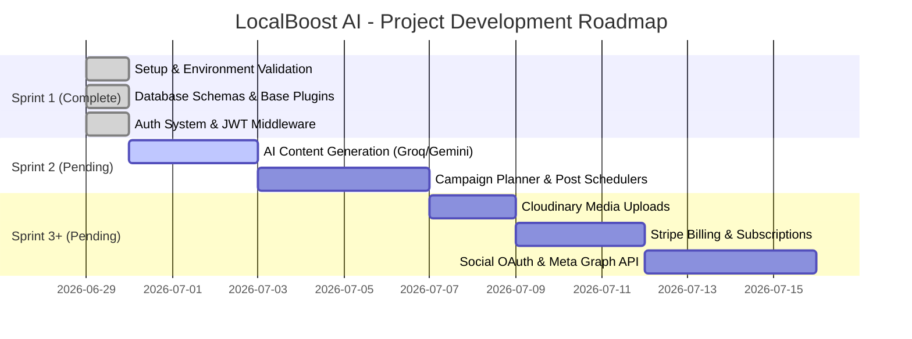

# LocalBoost AI - Project Context

This document captures the current development status, technical decisions, implemented features, and roadmap items for the LocalBoost AI application.

---

## 1. Project Objective

LocalBoost AI is a modern SaaS platform designed to help local businesses automate, plan, and schedule AI-optimized marketing campaigns and social media posts (Facebook, Instagram, Google Business). It provides smart content generation engines, localized target audience tailoring, automated scheduling, and performance monitoring.

---

## 2. Current Implementation Status

**Completed Sprint**: Sprint 1 (Authentication & Foundation)  
**Current Sprint**: Sprint 2 (Pending)  
**Architecture Status**: FROZEN (Do not modify the locked architecture)

As of the completion of Sprint 1, the core architecture and authentication flows are fully established.

### 2.1 Backend Core
- **Environment Management**: Mandatory startup validation in `env.js` checking critical variables (`MONGODB_URI`, `JWT_SECRET`, etc.).
- **Middlewares**: Request tracing (`X-Request-ID`), CORS, Helmet security headers, Gzip compression, logging (Morgan), and endpoint rate-limiting.
- **Error Boundaries**: Standardized custom operational exceptions mapping (`AppError`) with automated formatting for Mongoose and JWT errors.
- **Authentication**: JWT-based login, registration, password reset flows, and protected route middlewares (`protect.js`, `authorize.js`).
- **Validation**: Strict request payload validation using `express-validator`.
- **Graceful Shutdown**: Intercepts `SIGINT`/`SIGTERM` to cleanly close HTTP listeners and MongoDB connections.
- **Uptime Health**: Route endpoint GET `/api/v1/health` deployed and validated.

### 2.2 Data Layer & Mongoose ODM
- **Soft Deletion Plugin**: `basePlugin.js` automatically applies timestamps, ownership tags, and pre-query filters for soft-deleted documents.
- **User Schema**: Includes bcrypt hashing hooks, JWT resets, and robust `.toJSON` transforms to prevent leaking sensitive fields.
- **Audit Logging**: Fully integrated `AuditLog` mapping for all critical authentication actions (login, register, password reset).
- **Other Models**: Prepared schemas for Business, Post, Campaign, Subscription, Notification, and Integration models (for future Sprints).

---

## 3. Tech Stack

- **Runtime**: Node.js (`>=18.0.0`)
- **Web Framework**: Express
- **Database**: MongoDB (ODM: Mongoose)
- **Security & Limits**: Helmet, CORS, Express Rate Limit, bcryptjs, jsonwebtoken
- **Response Optimization**: Compression
- **Process Manager**: nodemon (development mode)

---

## 4. Planned Roadmap (Sprint & Feature Roadmap)

Below is the separation of what has been implemented vs. what is planned in future milestones:

