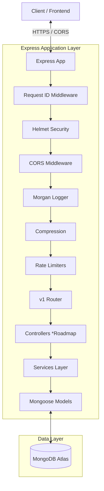
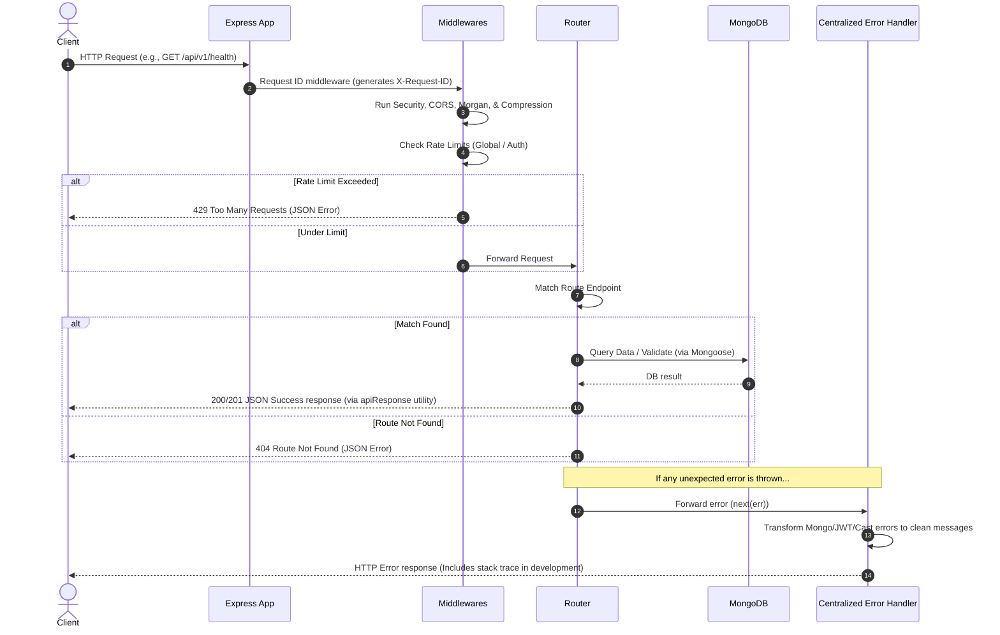

# LocalBoost AI - System Architecture

This document describes the high-level architecture, component directory structure, and request lifecycles of the LocalBoost AI backend.

---

## 1. High-Level Architecture Overview

LocalBoost AI is built as a modular monolithic Express API that communicates with a MongoDB database. The architecture focuses on security, robust error handling, predictability, and graceful recovery.



---

## 2. Directory Structure

The repository is divided into logical components. Below is the directory map of the backend:

```text
localboost-ai/
├── architecture/             # Architecture diagrams and specifications (placeholder)
├── frontend/                 # Frontend source (placeholder)
├── docs/                     # Project documentation
└── backend/                  # Backend application root
    ├── uploads/              # Local media uploads directory
    ├── src/
    │   ├── config/           # App configurations (database, environment validations)
    │   ├── constants/        # Application-wide enumerations and lists
    │   ├── controllers/      # Route request/response handlers (placeholder)
    │   ├── errors/           # Custom operational errors
    │   ├── jobs/             # Scheduled tasks and workers (placeholder)
    │   ├── middleware/       # Custom Express middlewares
    │   ├── models/           # Mongoose schemas and models
    │   │   └── plugins/      # Reusable Mongoose schemas plugins (e.g. soft delete)
    │   ├── routes/           # Express router endpoints
    │   │   └── v1/           # v1 API endpoints
    │   ├── services/         # Business logic layer
    │   │   └── base/         # Abstract core services
    │   ├── utils/            # Utility helpers (responses, tokens)
    │   └── validators/       # Request body schemas (placeholder)
    ├── .env                  # Local environment settings (git-ignored)
    ├── .env.example          # Environment blueprint
    ├── app.js                # Express app setup and middleware configuration
    └── server.js             # HTTP server listener and lifecycle management
```

---

## 3. Core Component Layers

1. **Server Layer (`server.js`)**: Entry point of the application. Validates environment variables, boots database connection, binds the HTTP server to a port, and listens for process exit signals (`SIGINT`, `SIGTERM`) to perform clean shutdown procedures.
2. **Application Middleware Layer (`app.js`)**: Chains security configurations (`helmet`, `cors`), performance optimization (`compression`), monitoring (`morgan`), security limiters (`express-rate-limit`), request context initialization (`X-Request-ID`), routing mapping, and error catchers.
3. **Routing Layer (`src/routes/`)**: Maps URI paths to controllers. Organizes routing by versioning (`v1/` routes).
4. **Service Layer (`src/services/`)**: Implements reusable business logic. Extends `BaseService` for abstracting pagination and common exceptions.
5. **Models Layer (`src/models/`)**: Manages ODM declarations with validation rules, database indices, and schema hooks. Inherits common properties via `basePlugin`.

---

## 4. Request Lifecycle

The diagram below details the path a request takes from the client until a response is sent back:


