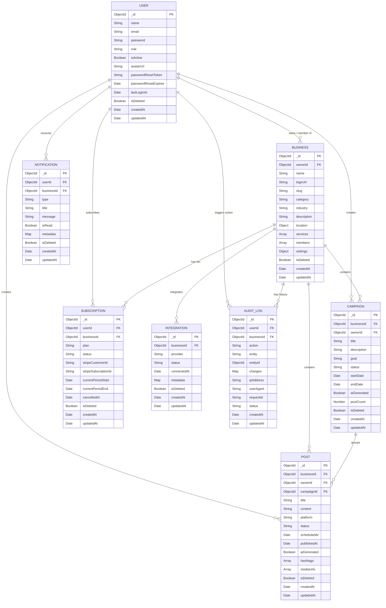

# LocalBoost AI - Database Schema Documentation

This document provides a breakdown of all MongoDB collections, Mongoose models, data relationships, indices, and core plugins currently implemented in the LocalBoost AI application.

---

## 1. Entity-Relationship Diagram

This diagram displays the references between different collections. 

---

## 2. Models Detail

### 2.1 User (`User.js`)
Stores user authentication information, profile details, resets, and permission roles.
- **Fields**:
  - `name` (String, required, 2-50 chars)
  - `email` (String, required, unique, lowercase, regex-validated)
  - `password` (String, required, min 8 chars, hidden by default in queries)
  - `role` (String, enum: `owner`, `manager`, `staff`, default: `owner`)
  - `isActive` (Boolean, default: `true`, for account disabling)
  - `avatarUrl` (String, default: `""`)
  - `passwordResetToken` (String, hidden by default)
  - `passwordResetExpires` (Date, hidden by default)
  - `lastLoginAt` (Date, default: `null`)
- **Indexes**:
  - `{ email: 1 }` (unique)
- **Hooks & Methods**:
  - Pre-save hook hashes password with `bcryptjs` (salt factor 12) if modified.
  - Instance method `comparePassword(candidatePassword)` returns comparative boolean.
  - Custom `toJSON` transform automatically strips `password`, `passwordResetToken`, `passwordResetExpires`, and `__v`.

### 2.2 Business (`Business.js`)
Contains business information, localized settings, team membership mappings, and posting schedules.
- **Fields**:
  - `ownerId` (ObjectId referencing User, required)
  - `name` (String, required, 2-100 chars)
  - `logoUrl` (String, default: `""`)
  - `slug` (String, unique, lowercase, auto-generated index)
  - `category` (String, required, enum of business types e.g., `salon`, `cafe`, etc.)
  - `industry` (String, default: `""`)
  - `description` (String, max 500 chars, default: `""`)
  - `location` (Object: `city`, `state`, `country`)
  - `services` (Array of Strings, default: `[]`)
  - `members` (Array of Member subdocuments: `userId`, `role`, `joinedAt`)
  - `settings`:
    - `tone` (String, enum: `professional`, `friendly`, `luxury`, `fun`, `casual`, default: `friendly`)
    - `timezone` (String, default: `"UTC"`)
    - `language` (String, default: `"en"`)
    - `targetAudience` (String, max 200 chars, default: `""`)
    - `autoApprovePosts` (Boolean, default: `false`)
    - `postingPreferences` (Object: `preferredDays` - array of strings, `preferredTime` - string)
- **Indexes**:
  - `{ ownerId: 1 }`
  - `{ slug: 1 }` (unique)
- **Hooks**:
  - Pre-save hook automatically parses `name` to generate a URL-friendly unique `slug` (appends random suffixes in case of collisions).

### 2.3 Post (`Post.js`)
Defines the structure for social media updates, scheduled publication dates, and publication status.
- **Fields**:
  - `businessId` (ObjectId referencing Business, required)
  - `ownerId` (ObjectId referencing User, required)
  - `campaignId` (ObjectId referencing Campaign, default: `null`)
  - `title` (String, max 150 chars, default: `""`)
  - `content` (String, required, max 2200 chars)
  - `platform` (String, enum: `instagram`, `facebook`, `google`, `manual`, default: `manual`)
  - `status` (String, enum: `draft`, `scheduled`, `published`, `failed`, default: `draft`)
  - `scheduledAt` (Date, default: `null`)
  - `publishedAt` (Date, default: `null`)
  - `aiGenerated` (Boolean, default: `false`)
  - `hashtags` (Array of Strings, default: `[]`)
  - `mediaUrls` (Array of Strings, default: `[]`)
- **Indexes**:
  - `{ businessId: 1, status: 1 }`
  - `{ businessId: 1, scheduledAt: 1 }`
  - `{ businessId: 1, createdAt: -1 }`

### 2.4 Campaign (`Campaign.js`)
Tracks groups of posts aligned under a single promotional goal.
- **Fields**:
  - `businessId` (ObjectId referencing Business, required)
  - `ownerId` (ObjectId referencing User, required)
  - `title` (String, required, max 150 chars)
  - `description` (String, max 500 chars, default: `""`)
  - `goal` (String, required, enum: `awareness`, `leads`, `sales`, `engagement`, `retention`)
  - `status` (String, enum: `draft`, `active`, `paused`, `completed`, default: `draft`)
  - `startDate` (Date, default: `null`)
  - `endDate` (Date, default: `null`)
  - `aiGenerated` (Boolean, default: `false`)
  - `postCount` (Number, default: `0`)
- **Indexes**:
  - `{ businessId: 1, status: 1 }`
  - `{ businessId: 1, createdAt: -1 }`

### 2.5 Subscription (`Subscription.js`)
Contains Stripe subscription details and application plan levels.
- **Fields**:
  - `userId` (ObjectId referencing User, required)
  - `businessId` (ObjectId referencing Business, required)
  - `plan` (String, enum: `starter`, `growth`, `pro`, default: `starter`)
  - `status` (String, enum: `active`, `cancelled`, `expired`, `trial`, default: `trial`)
  - `stripeCustomerId` (String, default: `null`)
  - `stripeSubscriptionId` (String, default: `null`)
  - `currentPeriodStart` (Date, default: `null`)
  - `currentPeriodEnd` (Date, default: `null`)
  - `cancelledAt` (Date, default: `null`)
- **Indexes**:
  - `{ userId: 1, businessId: 1 }`

### 2.6 Notification (`Notification.js`)
Provides notification templates for system warnings or campaign state alerts.
- **Fields**:
  - `userId` (ObjectId referencing User, required)
  - `businessId` (ObjectId referencing Business, default: `null`)
  - `type` (String, required, enum: `campaign_generated`, `post_published`, `post_failed`, `ai_finished`, `schedule_updated`, `system`)
  - `title` (String, required, max 150 chars)
  - `message` (String, required, max 500 chars)
  - `isRead` (Boolean, default: `false`)
  - `metadata` (Map of Mixed type objects, default: `{}`)
- **Indexes**:
  - `{ userId: 1, isRead: 1 }`
  - `{ userId: 1, createdAt: -1 }`

### 2.7 Integration (`Integration.js`)
Skeleton placeholder model tracking social media connections.
- **Fields**:
  - `businessId` (ObjectId referencing Business, required)
  - `provider` (String, required, enum: `instagram`, `facebook`, `google`)
  - `status` (String, enum: `connected`, `disconnected`, `error`, `pending`, default: `disconnected`)
  - `connectedAt` (Date, default: `null`)
  - `metadata` (Map of Mixed type objects, default: `{}`)
- **Indexes**:
  - `{ businessId: 1, provider: 1 }` (unique)

### 2.8 AuditLog (`AuditLog.js`)
Permanently stores logs of critical system behaviors, request identifiers, changes, and network origins.
**Note**: This model does *not* utilize `basePlugin`. Audit logs are designed to be permanent records that cannot be soft-deleted.
- **Fields**:
  - `userId` (ObjectId referencing User, default: `null`)
  - `businessId` (ObjectId referencing Business, default: `null`)
  - `action` (String, required)
  - `entity` (String, required)
  - `entityId` (ObjectId, default: `null`)
  - `changes` (Map of Mixed type objects, default: `{}`)
  - `ipAddress` (String, default: `""`)
  - `userAgent` (String, default: `""`)
  - `requestId` (String, default: `""`)
  - `status` (String, enum: `success`, `failure`, default: `success`)
- **Indexes**:
  - `{ userId: 1, createdAt: -1 }`
  - `{ businessId: 1, createdAt: -1 }`
  - `{ entity: 1, entityId: 1 }`

---

## 3. Custom Mongoose Plugins

### 3.1 Base Plugin (`basePlugin.js`)
Except for `AuditLog.js`, all database models utilize `basePlugin.js` which registers global properties and soft-deletion behavior:
1. **Added Fields**:
   - `isDeleted` (Boolean, default: `false`, indexed)
   - `createdBy` (ObjectId referencing User, default: `null`)
   - `updatedBy` (ObjectId referencing User, default: `null`)
2. **Timestamps**: Automatically enables default Mongoose `{ timestamps: true }` mapping (`createdAt` and `updatedAt` fields).
3. **Soft Delete Method**: Attaches the instance method `softDelete(userId)` which sets `isDeleted = true`, tags `updatedBy`, and saves the document.
4. **Pre-Query Middleware Hook**: Automatically intercepts all query hooks matching `/^find/` (e.g. `find`, `findOne`, `findOneAndUpdate`) and appends `.where({ isDeleted: false })` filters, preventing access to deleted records by default.
